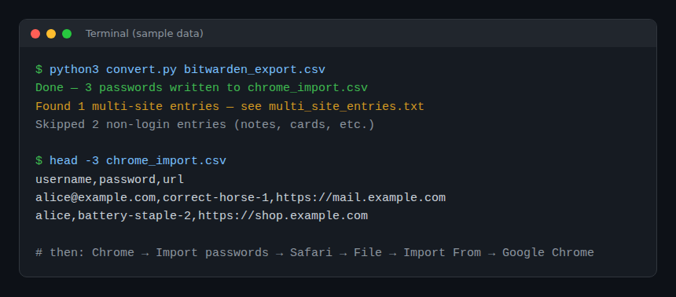

# Bitwarden to Apple Keychain Converter

Move your Bitwarden logins into Apple Passwords / iCloud Keychain with one dependency-free Python script.

[](https://github.com/MehdiMamas/bitwarden-to-apple-keychain-converter-script/actions/workflows/ci.yml)
[](LICENSE)



The script turns a Bitwarden CSV export into a file Chrome can import; Safari then imports it from Chrome, and everything syncs to iCloud Keychain.

Based on [big_smile's method](https://discussions.apple.com/thread/253920670?sortBy=rank) from the Apple Support Community. Thanks to them for the original approach.

## Quick start

In the folder holding your Bitwarden export:

```
curl -fsSLO https://raw.githubusercontent.com/MehdiMamas/bitwarden-to-apple-keychain-converter-script/master/convert.py && python3 convert.py <your_bitwarden_export.csv>
```

If `chrome_import.csv` or `multi_site_entries.txt` already exists next to the export, the script stops instead of overwriting it. Add `--force` to replace them.

Then follow the [import steps](#import-steps).

## Requirements

- Python 3 (no dependencies)
- Google Chrome (temporary, used as a bridge)
- Safari

## Usage

1. Export your passwords from Bitwarden as CSV
2. Run the script:

```
python3 convert.py <your_bitwarden_export.csv>
```

This produces two files:

- **`chrome_import.csv`** -- all your website logins in Chrome's import format (`username, password, url`). Non-login entries (notes, wifi passwords, cards, identities) are filtered out.
- **`multi_site_entries.txt`** -- a list of entries that had multiple websites in Bitwarden. Only the first URL is imported; this file tells you exactly which entries to find in Apple Passwords and which extra URLs to add manually.

## Import Steps

1. Open Chrome and go to `chrome://flags/#password-import-export` -- enable the import flag
2. Go to `chrome://settings/passwords`
3. Click the 3 dots above the password section and select "Import passwords"
4. Select the `chrome_import.csv` file
5. Restart Chrome and verify the passwords are there
6. Open Safari -- File -- Import From -- Google Chrome -- select Passwords
7. Passwords will sync to iCloud Keychain
8. Open `multi_site_entries.txt` and for each entry, find it in Apple Passwords and add the extra websites listed

## Notes

- Everything runs locally; the script makes no network calls. Delete the export, `chrome_import.csv` and `multi_site_entries.txt` once the import is done, since they hold your passwords in plain text
- The `.gitignore` excludes all CSV files and `multi_site_entries.txt` so your credentials are never committed
- Passkeys cannot be transferred via CSV -- they are cryptographic keys tied to the device that created them. You'll need to re-register passkeys on each site from Safari/iCloud Keychain directly

## Contributing

Issues and PRs are welcome; see [CONTRIBUTING.md](CONTRIBUTING.md). Never attach a real export.

## License

[MIT](LICENSE)
